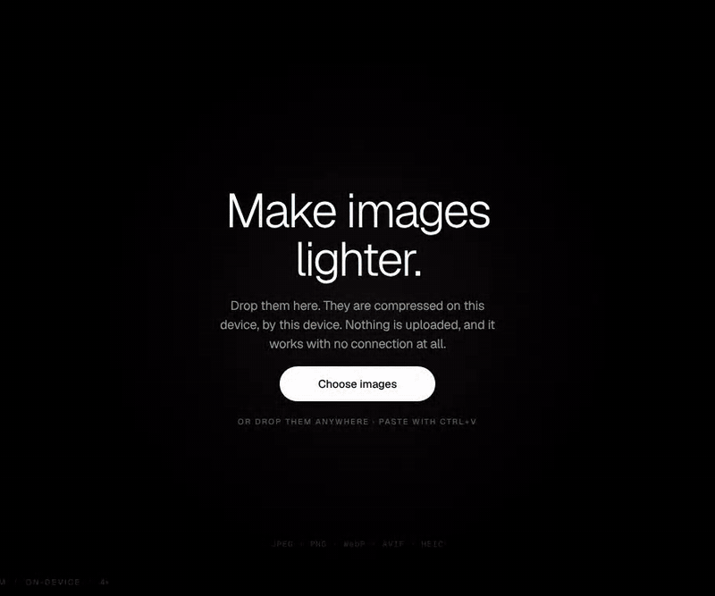

<p align="center">
  
</p>

<h1 align="center">Compresso</h1>

<p align="center">
  <strong>Compress, resize, and convert images in the browser.</strong><br />
  About 5 KB gzipped, with no runtime dependencies in its core: HEIC input through an optional decoder, parallel Web Worker batching, and never-bigger output when it picks the format. No server needed.
</p>

<p align="center">
  <a href="https://www.npmjs.com/package/compresso.js"></a>
  <a href="https://bundlephobia.com/package/compresso.js"></a>
  <a href="https://www.npmjs.com/package/compresso.js"></a>
  <a href="https://www.npmjs.com/package/compresso.js"></a>
  <a href="https://github.com/iziuqo/compresso/blob/main/LICENSE"></a>
  <a href="https://github.com/iziuqo/compresso/stargazers"></a>
</p>

<p align="center">
  <a href="https://apps.apple.com/app/id6829326032"></a>
</p>

<p align="center">
  <a href="https://compresso.izaias.xyz/compresso"><strong>▶ Try the live demo</strong></a> ·
  <a href="https://compresso.izaias.xyz/docs">Documentation</a> ·
  <a href="https://compresso.izaias.xyz/en/compare/">Compare</a> ·
  <a href="https://compresso.izaias.xyz/en/faq/">FAQ</a> ·
  <a href="#batch--parallel-compression">Batch & Workers</a>
</p>

<!-- Recorded from the live demo with the app store sample photos (no people or brands). -->
<p align="center">
  <a href="https://compresso.izaias.xyz/compresso">
    
  </a>
</p>

---

## Why Compresso

- **Small: about 5 KB gzipped, with no runtime dependencies in the core.** The core is the browser's own Canvas API, with no WASM and no bundled codecs. That's about the size of compressorjs, and three to four times smaller than browser-image-compression and pica ([see comparison](#comparison)).
- **iPhone HEIC/HEIF input.** Safari 17+ and iOS 17+ decode HEIC themselves. Other browsers use the optional [`heic-to`](https://www.npmjs.com/package/heic-to) decoder, which npm installs beside compresso.js and your bundler loads only the first time a HEIC file appears. It weighs about 0.8 MB gzipped and is LGPL-3.0; see [HEIC/HEIF input](#heicheif-input), including how to leave it out.
- **Never bigger, when Compresso picks the format.** With the default `format: 'auto'`, or a format the source is already in, a lossy result is never larger than the source: if no encode beats it, the source itself comes back, and the result says so (`kept: true`). An explicit conversion is honoured even when the file grows, and a negative `savings` shows it. PNG output is lossless and exempt. [How it works, and its limits](#never-bigger-and-its-limits).
- **Real parallel batch compression, off the main thread.** `compresso.js/pool` runs a resilient Web Worker pool — crash and timeout recovery included — for compressing many files at once without blocking the UI. Falls back to the exact same API on the main thread where Workers aren't available, so you never branch on environment yourself ([see Batch & Workers](#batch--parallel-compression)).
- **Modern by default.** `format: 'auto'` picks the best format the browser can really encode, proved by encoding a test image rather than trusting the browser's label: WebP in Chrome, Edge and Firefox, JPEG in Safari. It would pick AVIF where a browser truly encodes it, which none tested does yet ([see Browser Support](#browser-support)). Promise-based API and TypeScript types.
- **100% client-side** — no server round-trips, no API keys, no upload of user images anywhere. Private by construction.

## Install

```bash
npm install compresso.js
```

Or from a CDN:

```html
<script src="https://unpkg.com/compresso.js/dist/compresso.umd.js"></script>
```

Or as an ES module, straight from jsDelivr (it rewrites the optional HEIC decoder's import for you):

```html
<script type="module">
  import { compress } from 'https://cdn.jsdelivr.net/npm/compresso.js@1/+esm';
</script>
```

## Quick Start

```js
import { compress } from 'compresso.js';

const input = document.querySelector('input[type="file"]');

input.addEventListener('change', async (e) => {
  const file = e.target.files[0];

  const result = await compress(file, {
    quality: 0.8,
    maxWidth: 1920,
    format: 'auto', // AVIF / WebP / JPEG — best the browser supports
  });

  console.log(`${result.savings}% smaller`);
  // → "87.3% smaller"

  // Use result.file for upload, result.url for preview
});
```

## Comparison

How Compresso compares to the popular browser-side image libraries, checked on 2026-11-15:

| | **compresso.js** | compressorjs | browser-image-compression | pica |
|---|:---:|:---:|:---:|:---:|
| Bundle, min+gzip <sup>1</sup> | **5.2 KB** | 5.2 KB | 20.8 KB | 16.3 KB |
| Runtime dependencies <sup>2</sup> | **0** in the core; `heic-to` optional, for HEIC | 2 | 1 | 2 |
| HEIC / HEIF input | **✅** (natively in Safari, `heic-to` elsewhere) | ❌ | ❌ | ❌ |
| Picks the best format the browser encodes | **✅** | ❌ | ❌ | ❌ |
| Returns the original when no encode is smaller | ✅ with `format: 'auto'` | ✅ (`strict`, on by default) | ❌ | not applicable (resizes only) |
| Target file size | ✅ `maxSizeMB`, a target; `missedTarget` says when it's missed | ❌ | ✅ `maxSizeMB` | ❌ |
| Keeps EXIF metadata | ❌ (an original that comes back keeps its own) | ✅ `retainExif` (JPEG) | ✅ `preserveExif` | ❌ |
| Non-blocking (Web Worker) | **✅** (`compresso.js/pool`) | ❌ | ✅ | ✅ |
| API style | Promise | Callbacks | Promise | Promise |
| TypeScript types | ✅ | ✅ | ✅ | ✅ |
| Latest release <sup>3</sup> | 1.0.3, 2026-11-08 | 1.4.0, 2026-10-01 | 2.0.2, 2023-03-06 | 10.0.3, 2026-08-15 |
| License | MIT | MIT | MIT | MIT |

<sup>1</sup> Each package's default export bundled with esbuild (`--bundle --minify --format=esm`, dependencies included) and gzipped at level 9. compresso.js is this repository's main entry as it heads for 1.1, every export included; `compress()` alone is 4.8 KB. <sup>2</sup> The `dependencies` of each package's latest version on npm. <sup>3</sup> The publish date of each package's `latest` on npm. Features are from each package's own documentation and source at those versions.

**When *not* to use Compresso:** for server-side/batch processing use [sharp](https://github.com/lovell/sharp); for pixel-level image editing use [Jimp](https://github.com/jimp-dev/jimp); if you only need the highest-quality downscale, [pica](https://github.com/nodeca/pica) specializes in that. Compresso is for *optimizing user-selected images in the browser before upload.*

## Target a Maximum File Size

For systems with strict upload limits. `maxSizeMB` is a target, not a guarantee: check `missedTarget` before you rely on it.

```js
import { compress } from 'compresso.js';

const result = await compress(file, {
  maxSizeMB: 2, // aim for 2 MB or less
  format: 'auto',
});

if (result.missedTarget) {
  // Even the smallest file Compresso could make is over 2 MB.
}
```

Compresso searches for the highest quality that fits, in four encodes at most. When no quality fits,
it steps the image's size down, never below a 480 px long edge. If even that misses, the result is
the smallest file it made (or the source itself, `kept: true`, when even that isn't smaller), and
`result.missedTarget` is `true`. PNG output is lossless, so quality can't shrink it and a target
applies only through the size steps. An animated image or an SVG File or Blob comes back untouched,
so a target can't shrink it at all: `missedTarget` says when it's over.

## Batch & Parallel Compression

New in `1.0.0`: `compresso.js/pool` runs many compressions in parallel, off the main thread, via a resilient Web Worker pool — no UI jank on a 50-photo upload.

```js
import { createPool } from 'compresso.js/pool';

const input = document.querySelector('input[type="file"]');
const pool = createPool();

// input.files is a FileList; compressMany() takes an array.
const files = [...input.files];

// Files run in parallel and finish in any order, so report the whole batch.
const results = await pool.compressMany(files, { format: 'auto' }, (e) => {
  console.log(`${Math.round(e.overallProgress * 100)}% of ${e.totalFiles} files`);
});

const uploads = [];
for (const r of results) {
  if (r.status === 'fulfilled') uploads.push(r.value.file);
}

pool.destroy();
```

- **Same shape everywhere.** `createPool()` never throws for lack of Worker support (or a CSP that blocks worker construction) — it silently falls back to the exact same API on the main thread. You call it unconditionally; it decides how much parallelism the environment can actually offer.
- **Self-healing.** A worker that crashes (OOM, driver fault) or goes silent past its timeout — e.g. iOS backgrounding a tab — is detected and replaced automatically. `pool.stats().recoveries` tells you if it happened. A worker file that never loads, or a worker that keeps crashing, moves the pool to the main thread instead of retrying forever, and `pool.stats()` says so.
- **Never a whole-batch failure.** `compressMany()` results are `Promise.allSettled`-shaped — one file failing doesn't sink the other 49.

Full API (`createPool` options, `pool.stats()`, CSP requirements) is in the [package README](packages/compresso/README.md#batch--workers).

## API

### `compress(source, options?)`

Compresses a single image.

| Parameter | Type | Description |
|-----------|------|-------------|
| `source` | `File \| Blob \| string` | Image file, blob, or URL (HEIC/HEIF accepted) |
| `options` | `CompressOptions` | See below |

#### Options

| Option | Type | Default | Description |
|--------|------|---------|-------------|
| `quality` | `number` | `0.8` | Output quality, 0–1. The same number gives larger files in Safari than in Chrome or Firefox <sup>§</sup> |
| `maxWidth` | `number` | unbounded <sup>†</sup> | Maximum output width in px |
| `maxHeight` | `number` | unbounded <sup>†</sup> | Maximum output height in px |
| `format` | `string` | `'auto'` | `'jpeg'`, `'png'`, `'webp'`, `'avif'`, or `'auto'` |
| `maxSizeMB` | `number` | source size <sup>‡</sup> | Target output size in MB: quality is lowered, then the size steps down; `missedTarget` says when it's out of reach |
| `backgroundColor` | `string` | `'#ffffff'` | Background for transparent → JPEG |
| `onProgress` | `function` | — | Progress callback `({ progress, stage })` |
| `signal` | `AbortSignal` | — | Cancel compression |

<sup>§</sup> Each browser's encoder maps quality its own way: at 0.8, Safari's JPEG is more than twice the size of Chrome's or Firefox's, so a full-size photo may barely shrink there. A later release is planned to even this out; until then, a lower `quality` or a `maxSizeMB` target gives Safari users smaller files. <sup>†</sup> Original resolution is kept, except when neither dimension is set **and** the browser can't encode WebP/AVIF (auto falls back to JPEG, e.g. Safari) — then output is capped to a 2048px long edge to avoid a bloated re-encode, though never below a 720px short edge for shapes up to 32:1, so a long screenshot stays readable. Pass `Infinity` to never cap. <sup>‡</sup> With `format: 'auto'`, or a format the source is already in, lossy output is never larger than the source, regardless of this value. An explicit conversion is always honoured; a negative `savings` shows it grew. See [Never bigger, and its limits](#never-bigger-and-its-limits).

#### Result

| Property | Type | Description |
|----------|------|-------------|
| `file` | `File` | Optimized File object |
| `blob` | `Blob` | Optimized Blob |
| `url` | `string` | Object URL for preview |
| `width` / `height` | `number` | Output dimensions, as encoded: inside the format's edge limit (WebP: 16,383px) and the canvas the browser really gives |
| `originalSize` / `compressedSize` | `number` | Bytes before / after |
| `savings` | `number` | Reduction percentage |
| `format` / `mimeType` | `string` | What the output's bytes really are, in canonical names (`'jpeg'`, never `'jpg'`) |
| `kept` | `boolean` | The source itself came back, with its own name, type and size |
| `reason` | `string \| null` | Why the result isn't what was asked: `'not-smaller'` (kept, no encode beat it), `'unsupported-format'` (this browser can't encode the asked format, so it's in the best one it can), `'animated'` (an animated GIF, APNG or WebP File or Blob, kept untouched, since a re-encode would keep only its first frame) or `'vector'` (an SVG File or Blob, kept untouched and labelled `svg`); `null` when it is |
| `missedTarget` | `boolean` | `maxSizeMB` was out of reach even at the smallest size tried; the result is the smallest file made (or a kept source, animation or SVG larger than the target) |

### `compressMultiple(files, options?)`

Compress an array of files one after another, on the main thread. Same options as `compress`, with an extended progress callback that includes `fileIndex`, `totalFiles`, and `overallProgress`. For many files, [the pool](#batch--parallel-compression) runs them in parallel, off the main thread.

### `createCompressor(defaults?)`

Create a reusable instance with preset options:

```js
import { createCompressor } from 'compresso.js';

const optimizer = createCompressor({ quality: 0.7, maxWidth: 1200, format: 'auto' });
const result = await optimizer.compress(file);
```

### Utilities

```js
import { isFormatSupported, getBestFormat, formatBytes } from 'compresso.js';

isFormatSupported('webp'); // true when this browser really encodes WebP
getBestFormat();           // what format: 'auto' uses here: 'avif', 'webp' or 'jpeg'
formatBytes(1536000);      // '1.5 MB'
```

Pass `format: 'auto'` unless you need one format: Safari can't encode WebP or AVIF, so an explicit
`format: 'webp'` gives Safari users the best format it can make instead, with
`reason: 'unsupported-format'`. If you do need one, check `isFormatSupported()` first.

## Framework Examples

<details>
<summary><strong>React</strong></summary>

```jsx
import { useState } from 'react';
import { compress, formatBytes } from 'compresso.js';

function ImageUpload() {
  const [result, setResult] = useState(null);

  async function handleFile(e) {
    const file = e.target.files[0];
    if (!file) return;
    setResult(await compress(file, { quality: 0.8, maxWidth: 1920, format: 'auto' }));
  }

  return (
    <div>
      <input type="file" accept="image/*" onChange={handleFile} />
      {result && (
        <div>
          
          <p>{formatBytes(result.originalSize)} → {formatBytes(result.compressedSize)} ({result.savings}% smaller)</p>
        </div>
      )}
    </div>
  );
}
```

</details>

<details>
<summary><strong>Vue</strong></summary>

```vue
<script setup>
import { ref } from 'vue';
import { compress, formatBytes } from 'compresso.js';

const result = ref(null);

async function handleFile(e) {
  const file = e.target.files[0];
  if (!file) return;
  result.value = await compress(file, { quality: 0.8, maxWidth: 1920, format: 'auto' });
}
</script>

<template>
  <input type="file" accept="image/*" @change="handleFile" />
  <div v-if="result">
    
    <p>{{ formatBytes(result.originalSize) }} → {{ formatBytes(result.compressedSize) }} ({{ result.savings }}% smaller)</p>
  </div>
</template>
```

</details>

<details>
<summary><strong>Svelte</strong></summary>

```svelte
<script>
  import { compress, formatBytes } from 'compresso.js';

  let result = null;

  async function handleFile(e) {
    const file = e.target.files[0];
    if (!file) return;
    result = await compress(file, { quality: 0.8, maxWidth: 1920, format: 'auto' });
  }
</script>

<input type="file" accept="image/*" on:change={handleFile} />
{#if result}
  
  <p>{formatBytes(result.originalSize)} → {formatBytes(result.compressedSize)} ({result.savings}% smaller)</p>
{/if}
```

</details>

<details>
<summary><strong>Angular</strong></summary>

```ts
import { Component } from '@angular/core';
import { CommonModule } from '@angular/common';
import { compress, formatBytes } from 'compresso.js';

@Component({
  selector: 'app-image-upload',
  standalone: true,
  imports: [CommonModule],
  template: `
    <input type="file" accept="image/*" (change)="handleFile($event)" />
    <div *ngIf="result">
      
      <p>{{ formatBytes(result.originalSize) }} → {{ formatBytes(result.compressedSize) }} ({{ result.savings }}% smaller)</p>
    </div>
  `,
})
export class ImageUploadComponent {
  result: any = null;
  formatBytes = formatBytes;

  async handleFile(e: Event) {
    const file = (e.target as HTMLInputElement).files?.[0];
    if (!file) return;
    this.result = await compress(file, { quality: 0.8, maxWidth: 1920, format: 'auto' });
  }
}
```

</details>

<details>
<summary><strong>Solid</strong></summary>

```jsx
import { createSignal, Show } from 'solid-js';
import { compress, formatBytes } from 'compresso.js';

function ImageUpload() {
  const [result, setResult] = createSignal(null);

  async function handleFile(e) {
    const file = e.target.files[0];
    if (!file) return;
    const optimized = await compress(file, { quality: 0.8, maxWidth: 1920, format: 'auto' });
    const previous = result();
    if (previous) URL.revokeObjectURL(previous.url);
    setResult(optimized);
  }

  return (
    <div>
      <input type="file" accept="image/*" onChange={handleFile} />
      <Show when={result()} keyed>
        {(res) => (
          <div>
            
            <p>{formatBytes(res.originalSize)} → {formatBytes(res.compressedSize)} ({res.savings}% smaller)</p>
          </div>
        )}
      </Show>
    </div>
  );
}
```

Full working version: [`examples/solid/App.jsx`](examples/solid/App.jsx).

</details>

<details>
<summary><strong>Next.js (App Router) — upload recipe</strong></summary>

Compress client-side in a `'use client'` component, then upload the already-optimized file to a route handler:

```jsx
'use client';
import { useState } from 'react';
import { compress } from 'compresso.js';

export default function UploadForm() {
  const [status, setStatus] = useState('idle');

  async function handleFile(e) {
    const file = e.target.files[0];
    if (!file) return;

    const result = await compress(file, { quality: 0.8, maxWidth: 1920, format: 'auto' });

    setStatus('uploading');
    const body = new FormData();
    body.append('file', result.file);
    await fetch('/api/upload', { method: 'POST', body });
    setStatus('done');
  }

  return <input type="file" accept="image/*" onChange={handleFile} />;
}
```

```js
// app/api/upload/route.js
export async function POST(request) {
  const formData = await request.formData();
  const file = formData.get('file'); // already compressed — store as-is
  return Response.json({ ok: true, name: file.name });
}
```

Full working versions: [`examples/nextjs/UploadForm.jsx`](examples/nextjs/UploadForm.jsx) and [`examples/nextjs/route.js`](examples/nextjs/route.js).

</details>

<details>
<summary><strong>Vanilla JS (CDN)</strong></summary>

```html
<input type="file" accept="image/*" id="upload" />
<div id="output"></div>

<script src="https://unpkg.com/compresso.js/dist/compresso.umd.js"></script>
<script>
  document.getElementById('upload').addEventListener('change', async (e) => {
    const file = e.target.files[0];
    if (!file) return;
    const result = await Compresso.compress(file, { quality: 0.8, format: 'auto', maxSizeMB: 2 });
    document.getElementById('output').innerHTML =
      `
       <p>${Compresso.formatBytes(result.originalSize)} → ${Compresso.formatBytes(result.compressedSize)} (${result.savings}% smaller)</p>`;
  });
</script>
```

</details>

## Browser Support

What each browser decodes (input) and encodes (output) through compresso.js. Output is what the
device lab measured by encoding, not what the browser claims:

| | Chrome, Edge, Samsung Internet, Android | Firefox | Safari (macOS) | Safari (iOS, iPadOS) |
|---|---|---|---|---|
| **Input:** JPEG, PNG, GIF | ✅ | ✅ | ✅ | ✅ |
| **Input:** WebP | ✅ | ✅ | ✅ (14+) | ✅ (14+) |
| **Input:** AVIF | ✅ (Chrome 85+, Edge 121+) | ✅ (93+) | ✅ (16.4+) | ✅ (16.4+) |
| **Input:** HEIC / HEIF | with `heic-to` | with `heic-to` | ✅ (17+) | ✅ (17+) |
| **Output:** JPEG, PNG | ✅ | ✅ | ✅ | ✅ |
| **Output:** WebP | ✅ | ✅ | ❌ JPEG instead | ❌ JPEG instead |
| **Output:** AVIF | ❌ falls back | ❌ falls back | ❌ falls back | ❌ falls back <sup>1</sup> |
| `format: 'auto'` gives | WebP | WebP | JPEG | JPEG |

<sup>1</sup> iOS 26 labels lossless bytes as AVIF; compresso.js checks the bytes, so it isn't fooled.

Measured on every pull request in Playwright's Chromium 159, Firefox 159 and WebKit 27.2 (Safari's
engine) and in the oldest and newest iOS simulators GitHub offers, and on real iPhones with iOS 17.6
and 26.6. An animated GIF, APNG or WebP File or Blob comes back untouched (`reason: 'animated'`), and
so does an SVG one (`reason: 'vector'`).

The oldest versions each part runs in, from the JavaScript and browser features the built files use:

| You use | Chrome, Edge | Firefox | Safari | iOS Safari | Samsung Internet | Node |
|---|---|---|---|---|---|---|
| `compress()` | 81 | 74 | 13.1 | 13.4 | 13 | imports, but needs a browser to run |
| `compresso.js/pool` on workers <sup>2</sup> | 85 | 114 | 16.4 | 16.4 | 14 | ❌ |
| `compresso.js/plan` (since 1.1) | 92 | 90 | 15.4 | 15.4 | 16 | 16.6 |

<sup>2</sup> Older browsers still run the pool, on the main thread, with the same API.

Every pull request runs the tests in Chromium, Firefox and WebKit and on Node 22, 24 and 26, and the device lab in iPhone Safari on the oldest and newest iOS simulators. This project is tested with BrowserStack. Its real iPhones, Android phones and Macs cover what simulators cannot.

## HEIC/HEIF input

Safari 17+ and iOS 17+ decode HEIC themselves. Other browsers decode it with
[`heic-to`](https://www.npmjs.com/package/heic-to), an optional dependency that npm installs beside
compresso.js. Your bundler builds it from your copy, once, as a chunk of its own that loads only
the first time a HEIC file appears: about 3 MB, 0.8 MB gzipped. Output is always a web format
(HEIC is input only).

- **License:** `heic-to` is LGPL-3.0, and compresso.js never bundles or copies it. See
  [THIRD-PARTY-NOTICES.md](packages/compresso/THIRD-PARTY-NOTICES.md).
- **In the pool:** a worker that can't decode a HEIC asks the page, which decodes it with the same
  copy. Taking the decoded pixels pauses the page briefly, about 80 ms for a 12 MP photo in
  Chromium. Safari never pauses: it decodes HEIC itself.
- **The UMD build** (`compresso.umd.js` in a plain `<script>`) can't load `heic-to`, so there HEIC
  works only in Safari.
- **Leaving it out:** install with `npm install --omit=optional`, then tell your bundler not to look
  for it. In Vite, add `build: { rollupOptions: { external: ['heic-to'] } }` to `vite.config.js`. In
  webpack or Rspack, add `new IgnorePlugin({ resourceRegExp: /^heic-to$/ })` to `plugins`. Every
  other format works as before. A HEIC file then rejects with an error that says `heic-to` is
  missing, except in Safari, which decodes it itself.

## Never bigger, and its limits

With the default `format: 'auto'`, or a format the source is already in, Compresso never returns a
lossy file larger than the source. It works like this:

- **One encode decides.** With no target and no resize, Compresso encodes once at your `quality`.
  If that isn't smaller than the source, the source itself comes back, untouched, with `kept: true`
  and `reason: 'not-smaller'`. When it resizes, it first searches for the highest quality that stays
  under the source's size.
- **In Safari,** which can only make JPEG here, `format: 'auto'` with no `maxWidth` or `maxHeight`
  caps a photo at a 2048 px long edge (never below a 720 px short edge), since a full-size JPEG can
  be larger than the source. An explicit `format: 'jpeg'` isn't capped.

The limits:

- **An explicit conversion is honoured,** even when the file grows: `format: 'png'` can be ten
  times the size of a JPEG source. A negative `savings` shows it.
- **PNG output** is lossless, so quality doesn't shrink it.
- **A URL source** reports `originalSize: 0` and `savings: 0`, so compare sizes yourself, and the
  server must allow CORS.
- **A kept original** is the original's bytes, metadata included, labelled with the format those
  bytes really are.

## Metadata (EXIF and GPS)

Every image Compresso re-encodes comes back **without metadata**: no EXIF, no GPS location, no
camera details. The photo is turned upright first, so it looks the same without
its orientation tag.

An image that comes back untouched (`kept: true`: no encode was smaller, an animation, or an SVG)
is the original file, **with all its metadata, GPS included**. If you need location data gone, check
`kept` and strip it yourself, or pass a `maxWidth`, a `maxSizeMB` or an explicit `format`, which
make a re-encode likely but don't guarantee one.

## Content-Security-Policy (CSP)

Compresso itself needs nothing beyond `script-src 'self'`. The one exception is **HEIC/HEIF input on non-Safari browsers**, which lazily loads the `heic-to` WASM decoder — a strict CSP needs a couple of extra directives for that path specifically:

- **`script-src`: add `'unsafe-eval'`.** `heic-to`'s default build doesn't run with the narrower `'wasm-unsafe-eval'` alone (tested in Chromium).
- **`worker-src`: add `blob:`.** `heic-to` decodes in a worker it starts from a `blob:` URL. A blocked decode rejects with `HEIC decoding failed`, and the decoder then stays broken for the rest of that page.
- **`worker-src 'self'`** (plus `child-src 'self'` as a fallback for browsers that predate `worker-src`) if you use `compresso.js/pool` for batch compression — it runs a same-origin module Worker (`new Worker(new URL('./worker.js', import.meta.url))`), no third-party origin involved.
- **`img-src` needs `blob:`** if you render `result.url` directly in an `` — it's an object URL, not an http(s) URL.
- Using the CDN build (`<script src="https://unpkg.com/compresso.js/...">`) instead of installing from npm? Add `unpkg.com` to `script-src` too, or self-host the file to avoid a third-party origin in your policy.

Everything else — the core compressor, `compress()`, `compressMultiple()` — is plain same-origin JS with no `eval`, no inline scripts, and no network requests, so it needs no CSP allowances beyond your app's own bundle.

Example policy covering both the pool and HEIC input:

```
Content-Security-Policy: script-src 'self' 'unsafe-eval'; worker-src 'self' blob:; img-src 'self' blob:;
```

## FAQ

### How do I compress an image in the browser before uploading?
Read the file from an `<input type="file">`, pass it to `compress(file, { quality, maxWidth })`, and upload `result.file`. See [Quick Start](#quick-start). Everything runs client-side — the image never leaves the browser until *you* upload it.

### How do I convert a HEIC image to JPEG or WebP in JavaScript?
Pass the `.heic`/`.heif` file straight to `compress(file, { format: 'auto' })`. Compresso decodes HEIC (natively on Safari, with the optional `heic-to` decoder elsewhere) and outputs a standard web format. See [HEIC/HEIF input](#heicheif-input).

### Why did my compressed image get *bigger* than the original?
Re-encoding an already-efficient source (like an iPhone HEIC) to JPEG can *inflate* it. With `format: 'auto'`, Compresso doesn't let that happen to lossy output: when the encode isn't smaller you get the source back with `kept: true`, and in Safari it caps the resolution so a JPEG has a chance to be smaller. An explicit `format` is a request to convert, so it is honoured even when the file grows, and a negative `savings` shows it. See [Never bigger, and its limits](#never-bigger-and-its-limits).

### Does it keep EXIF and GPS data?
Not on a re-encode: the result has no metadata. An original that comes back untouched (`kept: true`) keeps all of its own, GPS included. See [Metadata](#metadata-exif-and-gps).

### Does it need a server or backend?
No. Compresso is 100% client-side (Canvas API). No servers, no API keys, no image ever uploaded to a third party.

### Does it work with React, Vue, and Next.js?
Yes — it's framework-agnostic. See [Framework Examples](#framework-examples).

### How do I compress many images in parallel without blocking the UI?
Import `createPool` from `compresso.js/pool` instead of using `compress()` directly — it runs a Web Worker pool with the same API, falling back to the main thread automatically where Workers aren't available. See [Batch & Parallel Compression](#batch--parallel-compression).

### My site has a strict CSP — why does HEIC input fail?
It's almost always a missing `'unsafe-eval'` in `script-src` or `blob:` in `worker-src`, both of which the HEIC decoder needs, or a missing `worker-src 'self'` if you're using `compresso.js/pool`. See [Content-Security-Policy](#content-security-policy-csp) for a full policy example.

## How It Works

Compresso's 5 KB core uses the browser's native Canvas API — no WASM, no heavy codecs, no server round-trips. (The one exception: HEIC/HEIF input on non-Safari browsers loads the optional `heic-to` decoder on demand.)

1. **Load** — decode the image (an `` element on the page, an `ImageBitmap` in a worker)
2. **Resize** — compute target dimensions (preserving aspect ratio), with step-down resizing for quality
3. **Compress** — draw to `<canvas>`, export as the target format at the chosen quality
4. **Fit** — with a max size, search for the highest quality that fits, and step the size down when none does; without one, keep the source when the encode isn't smaller

The result is a new `File` ready for upload, plus metadata about the optimization.

## Why This Exists

Every day, millions of people fail simple file uploads — government portals, banking apps, and healthcare systems reject documents over size limits, unsupported formats, or obscure requirements. Users are forced to figure out compression, conversion, and resizing themselves: tasks systems should handle transparently. Researchers call this **externalized processing**. Compresso eliminates it — drop it into any upload flow and images are optimized before they ever leave the browser.

For a government document system handling **100,000 submissions/month**:

| Metric | Without | With Compresso |
|--------|---------|----------------|
| Avg. file size | 4.2 MB | 0.4 MB |
| Monthly bandwidth | 420 GB | 40 GB |
| Upload failures | ~15% | ~0% |

This project is grounded in research on cognitive distance and externalized processing in document-submission systems (*Izaias Cavalcanti*). See the [research](https://github.com/iziuqo/compresso/blob/main/_articles/%5BIzaias%5D%20Cognitive%20Distance%20in%20Document%20Submission%20Systems.pdf).

## Contributing

Contributions welcome — see [CONTRIBUTING.md](CONTRIBUTING.md) and the [good first issues](https://github.com/iziuqo/compresso/issues). Bug reports, framework recipes, and benchmark additions are all appreciated.

## License

[MIT](LICENSE) © Izaias Cavalcanti

---

<p align="center">
  Made with care for the people who struggle with file uploads.<br />
  <a href="https://compresso.izaias.xyz">compresso.izaias.xyz</a>
</p>
