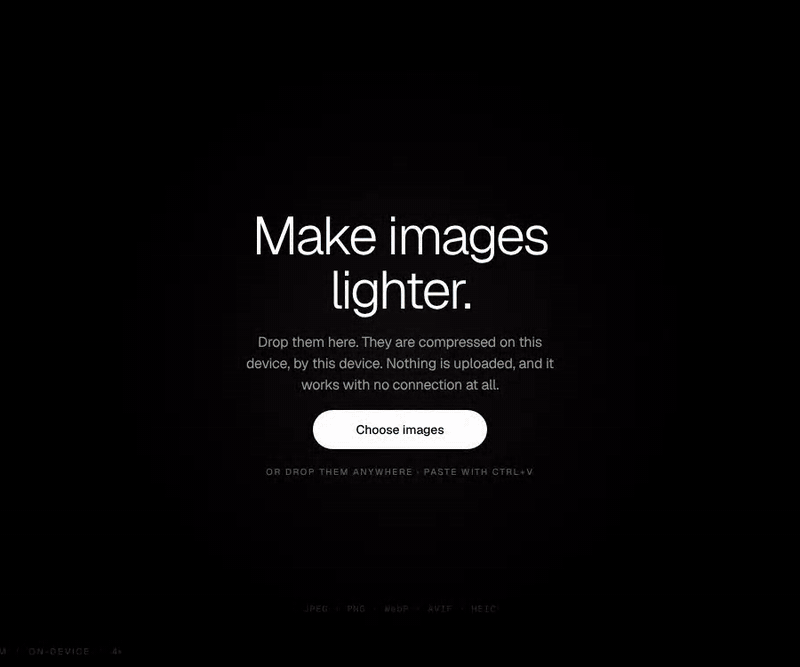

# Compresso

Small image optimizer that runs entirely in the browser, with no runtime dependencies in its core. Compress, resize, and convert images on the client side — no server needed.

[](https://www.npmjs.com/package/compresso.js)
[](https://bundlephobia.com/package/compresso.js)
[](https://www.npmjs.com/package/compresso.js)
[](https://www.npmjs.com/package/compresso.js)
[](https://github.com/iziuqo/compresso/blob/main/LICENSE)

**About 5 KB gzipped** · **No runtime dependencies in the core** · **HEIC/HEIF input (optional decoder)** · **Parallel Web Worker batching** · **Never bigger when it picks the format**

[Website](https://compresso.izaias.xyz) · [Live demo](https://compresso.izaias.xyz/compresso) · [Documentation](https://compresso.izaias.xyz/docs) · [FAQ](https://compresso.izaias.xyz/en/faq/) · [Compare](https://compresso.izaias.xyz/en/compare/) · [GitHub](https://github.com/iziuqo/compresso)

[](https://compresso.izaias.xyz/compresso)

## Why Compresso

- **Small** — about 5 KB gzipped, with no runtime dependencies in the core: about the size of [compressorjs](https://www.npmjs.com/package/compressorjs), and three to four times smaller than [browser-image-compression](https://www.npmjs.com/package/browser-image-compression) and [pica](https://www.npmjs.com/package/pica) ([full comparison](https://github.com/iziuqo/compresso#comparison)). Pure Canvas API — no WASM, no codecs bundled into the core.
- **iPhone HEIC/HEIF input** — Safari 17+ and iOS 17+ decode it themselves; other browsers use the optional `heic-to` decoder (LGPL-3.0, about 0.8 MB gzipped), loaded only the first time a HEIC file appears. See [HEIC/HEIF input](#heicheif-input), including how to leave it out.
- **Never bigger when it picks the format** — with the default `format: 'auto'`, a lossy result is never larger than the source. If no encode can beat an already-efficient source, the source itself comes back with `kept: true`. An explicit `format` is always honoured, and the result shows when it grew. See the [limits](https://github.com/iziuqo/compresso#never-bigger-and-its-limits).
- **Real parallel batch compression** — `compresso.js/pool` runs a Web Worker pool with crash/timeout recovery, falling back to the identical API on the main thread where Workers aren't available. See [Batch & Workers](#batch--workers).
- **100% client-side** — no server round-trips, no API keys, no user image ever uploaded anywhere.

## Comparison

| | **compresso.js** | compressorjs | browser-image-compression | pica |
|---|:---:|:---:|:---:|:---:|
| Bundle, min+gzip | **5.2 KB** | 5.2 KB | 20.8 KB | 16.3 KB |
| Runtime dependencies | **0** in the core; `heic-to` optional | 2 | 1 | 2 |
| HEIC / HEIF input | **✅** | ❌ | ❌ | ❌ |
| Picks the best format the browser encodes | **✅** | ❌ | ❌ | ❌ |
| Returns the original when no encode is smaller | ✅ with `format: 'auto'` | ✅ (`strict`) | ❌ | not applicable |
| Non-blocking (Web Worker) | **✅** (`compresso.js/pool`) | ❌ | ✅ | ✅ |
| TypeScript types | ✅ | ✅ | ✅ | ✅ |

Checked 2026-11-15: each package bundled with esbuild and gzipped, against compressorjs 1.4.0, browser-image-compression 2.0.2 and pica 10.0.3. How it was measured, every row's source, and when *not* to reach for Compresso are in the [project README](https://github.com/iziuqo/compresso#comparison).

## Install

```bash
npm install compresso.js
```

Or via CDN:

```html
<script src="https://unpkg.com/compresso.js/dist/compresso.umd.js"></script>
```

Or as an ES module, straight from jsDelivr (it rewrites the optional HEIC decoder's import for you):

```html
<script type="module">
  import { compress } from 'https://cdn.jsdelivr.net/npm/compresso.js@1/+esm';
</script>
```

## Usage

```js
import { compress } from 'compresso.js';

const input = document.querySelector('input[type="file"]');

input.addEventListener('change', async (e) => {
  const result = await compress(e.target.files[0], {
    quality: 0.8,
    maxWidth: 1920,
    format: 'auto', // the best format this browser really encodes
  });

  console.log(`${result.savings}% smaller`);
  // result.file → optimized File, ready for upload
});
```

## Target a Maximum File Size

`maxSizeMB` is a target, not a guarantee: check `missedTarget`.

```js
import { compress } from 'compresso.js';

const result = await compress(file, {
  maxSizeMB: 2,
  format: 'auto',
});

if (result.missedTarget) {
  // Even the smallest file Compresso could make is over 2 MB.
}
```

Quality is lowered first, then the size steps down, never below a 480 px long edge. When even
that misses, the result is the smallest file made, with `missedTarget: true`. PNG output ignores
quality, and an animated image or an SVG comes back untouched, so for those a target can only be
reported missed.

## HEIC/HEIF input

iPhone HEIC/HEIF photos are accepted as input and converted to a web format (HEIC is input
only). Safari 17+ and iOS 17+ decode them natively; other browsers load an optional decoder
([`heic-to`](https://www.npmjs.com/package/heic-to)) on the first HEIC image, so the core stays
codec-free for every other format. That chunk is about 3 MB, 0.8 MB gzipped.

`heic-to` is an optional dependency under the LGPL-3.0. npm installs it beside
compresso.js as its own package, and compresso.js never bundles it: your bundler builds
it from your copy, once, as its own chunk (see `THIRD-PARTY-NOTICES.md`). In the pool, a
worker that can't decode a HEIC natively asks the page, which decodes it with that same
copy and hands the worker the pixels. Taking the decoded pixels on the page pauses it
briefly, about 80 ms for a 12 MP photo in Chromium; Safari decodes HEIC natively and never
pauses. The plain CDN `<script>` build can't load `heic-to`, so there HEIC works only in Safari.

To leave HEIC out, install with `npm install --omit=optional` and tell your bundler not to look
for `heic-to`: in Vite, `build: { rollupOptions: { external: ['heic-to'] } }`; in webpack or
Rspack, `new IgnorePlugin({ resourceRegExp: /^heic-to$/ })` in `plugins`. Every other format
works as before, and a HEIC file then rejects with an error that says `heic-to` is missing,
except in Safari, which decodes it itself.

## Options

| Option | Type | Default | Description |
|--------|------|---------|-------------|
| `quality` | `number` | `0.8` | Output quality, 0–1. Not portable between browsers: at 0.8, Safari's JPEG is about 2.3 times the size of Chrome's or Firefox's (a later release is planned to even this out) |
| `maxWidth` | `number` | unbounded¹ | Max output width in px |
| `maxHeight` | `number` | unbounded¹ | Max output height in px |
| `format` | `string` | `'auto'` | `'jpeg'` \| `'png'` \| `'webp'` \| `'avif'` \| `'auto'` |
| `maxSizeMB` | `number` | source size² | Target file size in MB: quality is lowered, then the size steps down; the result's `missedTarget` says when it's out of reach |
| `maxInputPixels` | `number` | `100_000_000` | Max decodable input resolution (width × height). Guards against a crafted file declaring an enormous resolution from a tiny file. `Infinity` to disable |
| `onProgress` | `function` | — | Progress callback |
| `signal` | `AbortSignal` | — | Cancel compression |

¹ Original resolution is kept by default. The one exception: when neither `maxWidth` nor `maxHeight` is set **and** the browser can't encode WebP/AVIF (auto-format falls back to JPEG — e.g. Safari), output is capped to a **2048px long edge**, because a full-resolution JPEG re-encode could otherwise grow larger than the original. The cap never takes the short edge below 720px for shapes up to 32:1, so a long screenshot or a panorama stays readable. Browsers with a modern format keep the original dimensions. Set either axis to constrain it yourself, or pass `maxWidth: Infinity` to never cap. In every case output stays inside what can really be made: each format's edge limit (WebP holds 16,383px, and every format stays within 32,767px, the most every engine's canvas holds) and the canvas the browser really gives (an iPhone on iOS 17 holds about 16.7 MP, so a 24 MP photo comes back at about 12 MP there). `width` and `height` always report what was encoded.

² **Lossy output (JPEG/WebP/AVIF) is never larger than the source** with `format: 'auto'`, or in a format the source is already in, regardless of `maxSizeMB`. An explicit conversion is always honoured, and a negative `savings` shows it grew. PNG output is exempt, since it's lossless and ignores quality. Every result says what happened: `format` and `mimeType` name what the bytes really are, `kept` is `true` when the source itself came back, and `reason` says why a result isn't what was asked (`'not-smaller'`, `'unsupported-format'`, `'animated'` for an animated GIF, APNG or WebP File or Blob, or `'vector'` for an SVG one, both of which always come back untouched), or is `null`.

**Metadata:** a re-encoded image comes back without EXIF, GPS or camera details, turned upright
first. One that comes back untouched (`kept: true`) is the original file, with all its metadata,
GPS included: check `kept` if location data must not leave the device.

**Output formats:** `format: 'auto'` gives WebP in Chrome, Edge and Firefox, and JPEG in Safari,
which can't encode WebP or AVIF; no browser tested encodes AVIF yet. Every format is proved by
encoding a test image, not by the browser's label. The full table of what each browser decodes
and encodes is in the [project README](https://github.com/iziuqo/compresso#browser-support).

## Batch & Workers

Compress many files in parallel, off the main thread:

```js
import { createPool } from 'compresso.js/pool';

const input = document.querySelector('input[type="file"]');
const pool = createPool();

// input.files is a FileList; compressMany() takes an array.
const files = [...input.files];

// Files run in parallel and finish in any order, so report the whole batch.
const results = await pool.compressMany(files, { quality: 0.8, format: 'auto' }, (event) => {
  console.log(`${Math.round(event.overallProgress * 100)}% of ${event.totalFiles} files`);
});

const uploads = [];
for (const result of results) {
  if (result.status === 'fulfilled') uploads.push(result.value.file);
  else console.error('One file failed:', result.reason);
}

pool.destroy(); // stop the workers once you're done with the pool, e.g. on unmount
```

`compressMany()` never rejects for an individual file's failure — the returned array is
`Promise.allSettled`-shaped, one entry per input file, in input order. Only a caller error (e.g.
passing something that isn't an array) rejects the call itself.

`createPool()` never throws for lack of `Worker`/`OffscreenCanvas` support, or when a page's CSP
blocks worker construction — it silently falls back to a correct, serial, main-thread
implementation with the **exact same shape** (`compress`, `compressMany`, `cancel`, `destroy`,
`stats`). Call `createPool()` unconditionally and let it choose; don't branch on the environment
yourself. Use `isPoolSupported()` only if you want to decide whether to *show* a batch UI at all —
the pool itself works correctly either way. Every `compress()` option, including `maxInputPixels`
(see [Options](#options)), applies identically on the pool path.

### API

| | |
|---|---|
| `createPool(options?)` | Creates a pool. See options below. |
| `isPoolSupported()` | `true` if this environment can run a real worker pool (`Worker` + `OffscreenCanvas`). |
| `defaultPoolSize()` | The worker count `createPool()` uses when `size` isn't set — CPU cores, capped at 8, further capped on detected low-memory devices. |
| `pool.compress(file, options?)` | Compress one file. Same `options` as `compress()`. |
| `pool.compressMany(files, options?, onProgress?)` | Compress many files. See above. |
| `pool.cancel(id)` | Cancel a queued or in-flight job by id. No-op for an unknown id. |
| `pool.destroy()` | Cancel every queued and in-flight job, then terminate all workers. |
| `pool.stats()` | `{ size, busy, queued, recoveries, mode, reason }` — a snapshot of the pool's current load. `recoveries` counts workers replaced after a crash or timeout; a nonzero value is a real, actionable signal for a bug report. `mode` is `'workers'` or `'main-thread'`, and `reason` says why a pool runs on the main thread (`'workers-unsupported'`, `'worker-blocked'`, `'worker-failed-to-load'` or `'worker-crashed-repeatedly'`), or is `null` while it uses workers. |

`createPool(options)`:

| Option | Type | Default | Description |
|--------|------|---------|-------------|
| `size` | `number` | `defaultPoolSize()` | Number of workers to spawn. |
| `workerUrl` | `string \| URL` | built-in `worker.js` | Override the worker script's location — for bundlers that can't resolve it automatically, or a CSP-nonce'd hosting path. |
| `heicToUrl` | `string \| URL` | — | Deprecated: since 1.1 it does nothing. Workers no longer load the HEIC codec; the page decodes HEIC for them with your app's own `heic-to`. Still accepted, so existing code keeps working. |
| `maxQueueLength` | `number` | unbounded | Once this many jobs are waiting, further `compress()`/`compressMany()` calls reject immediately with `kind: 'queue-full'` instead of growing the queue further. |
| `timeoutMs` | `number` | `30000` | Milliseconds a job may go without reporting progress before its worker is considered stuck, terminated, and replaced. The clock restarts on every progress message, so a long job that keeps working is never cut off, and it scales with the photo: 12 MP or smaller gets `timeoutMs`, 48 MP four times as much, counting up to `maxInputPixels`. Guards against a silently-suspended worker (e.g. iOS backgrounding a tab) or a hung decode. `Infinity` to disable. |

A worker that crashes natively (OOM, a driver fault) or goes silent past `timeoutMs` is detected
and replaced automatically — a batch never hangs forever on one bad worker. `pool.stats().recoveries`
is how you'd notice this happened.

The pool never retries without end. Each worker says it is ready once its script has loaded; a
worker that fails before that (a wrong `workerUrl`, a 404, a bundler that didn't emit the file)
stops the pool spawning workers at all, and its jobs carry on on the main thread. A worker that
crashes mid-job is replaced at most twice in a row; on a third crash in a row, the job that crashed
is rejected and the pool stops spawning workers too. Either way the other running and queued jobs
carry on on the main thread, one at a time, every later job runs there too, and `pool.stats()`
reports `mode: 'main-thread'` with the reason. From then on the pool behaves like the main-thread
pool: `cancel()` and `destroy()` can't stop a job already running, but an `AbortSignal` still can.

An SVG File or Blob comes back untouched, with `reason: 'vector'`. A worker can't decode SVG, so
even a pool on workers returns it from the main thread, the way the main-thread pool does: outside
`maxQueueLength` and `pool.stats()`, and only an `AbortSignal` can stop it.

### Content-Security-Policy

Constructing the worker needs `worker-src` (or the `script-src`/`default-src` fallback chain) to
permit the worker's own origin — it ships same-origin, alongside your app's own bundle. A CSP that
blocks worker construction doesn't throw — `createPool()` catches it and falls back to the serial
main-thread path automatically.

HEIC that the browser can't decode natively goes through `heic-to` on the page, for the main
thread and the pool alike, and its decoder needs two more sources: `blob:` in `worker-src`, since
it decodes in a worker it starts from a `blob:` URL, and `'unsafe-eval'` in `script-src`, since
its default build doesn't run with `'wasm-unsafe-eval'` alone (tested in Chromium). A blocked
decode rejects with `HEIC decoding failed`, and `heic-to`'s decoder then stays broken for the rest
of that page: later HEIC decodes there never finish on the main thread, and time out in the pool.

### If you've rolled your own worker pool

`createPool()`/`compressMany()` is a generalized, hardened version of the kind of pool a
compress-heavy app ends up hand-building: a fixed worker count, a task queue, cancellation, and
(per the resilience notes above) crash/timeout recovery most hand-rolled pools don't have yet.
Migrating usually means: delete your own `pool.ts`/`worker.ts`, import `createPool`/
`isPoolSupported` from `compresso.js/pool`, and re-express any app-specific policy (e.g. "only the
latest preview request matters") as a small wrapper around `createPool({ size: 1 })` at your own
app layer, rather than baking it into the pool itself.

## Bring your own encoder: the planner

> **Since 1.1.** `compresso.js/plan` ships in 1.1.0. Until then it's on npm's `next` tag
> (`npm install compresso.js@next`); 1.0.x, npm's `latest`, doesn't have it.

`compresso.js/plan` is the deciding half of `compress()` with no pixels in it: which format,
which quality, and how small, under the same never-bigger rule. Any host that can encode (iOS
ImageIO, Android `Bitmap`, a server, a test fake) plugs in through a small adapter and gets the
same answers. It has no DOM dependency, so it runs in React Native and Node too (ESM and CommonJS).

```js
import { planPhoto, allocateBudget } from 'compresso.js/plan';

// "All of these under 10 MB": one target per photo, in proportion to its size.
const targets = allocateBudget(10_000_000, photos.map((photo) => photo.size));

const decision = await planPhoto(
  {
    formats: ['webp', 'jpeg'], // what this host can write, best first
    prepare: (maxLongEdge) => myDecode(photo, maxLongEdge), // → { width, height, originalSize, transformed? }
    measure: (format, quality) => myEncodedSize(format, quality), // bytes, in memory
    write: (format, quality) => myWrite(format, quality),
    keep: async () => photo, // no encode tried was smaller
    release: () => myFree(),
  },
  { formats: ['avif', 'webp', 'jpeg'], quality: 0.8, targetBytes: targets[0] },
);
// → { result, format, quality, kept, missedTarget }
```

When no quality meets `targetBytes`, the planner steps the long edge down, by 20% or by as much as
the bytes still missing say, and searches again (never below 480 px), then gives the smallest file it can make with `missedTarget: true`.
`findQuality` (the quality search on its own) and `resolveFormat` are exported too; see
`types/plan.d.ts` for the full contract.

### Video

Phones encode video on a hardware chip, so a clip can't be test-encoded ten times like a photo.
`planVideo` works the settings out from the numbers instead, the host encodes once, and if the
encoder overshoots (hardware lands within about 5–10% of the bitrate it's asked for), one
correction pass runs with the overshoot priced in. The host can be Media3 on Android,
AVFoundation on iOS or WebCodecs; compresso.js itself never touches a frame.

```js
import { planVideo } from 'compresso.js/plan';

const decision = await planVideo(
  {
    source: { width: 3840, height: 2160, fps: 30, durationMs: 60_000, hasAudio: true, originalSize },
    codecs: ['hevc', 'h264'], // what this host can write, best first
    // settings → { codec, width, height, fps, videoBitrate, audioBitrate, bytes }
    encode: (settings, { signal, onProgress }) => myEncode(settings), // → { result, bytes }
    keep: async () => clip, // nothing smaller was possible
    discard: (result) => myDelete(result), // an encode the planner won't use
  },
  { codecs: ['hevc', 'h264'], targetBytes: 10_000_000 }, // "fits Discord's 10 MB"
);
// → { result, settings, kept, missedTarget }
```

Without a target, `quality` (default 0.8) sets the bits per pixel at the source's own size. With
one, the budget becomes a bitrate (8% left for MP4 overhead and encoder misses), the frame rate
caps at 30, AAC audio takes 96 kbps (64 kbps when tight), and the resolution steps down a ladder
of standard heights (2160, 1440, 1080, 720, 540, 480, 360) until each pixel gets enough bits to
look clean rather than blocky. The output is never bigger than the source. `fitVideo(source,
recipe)` is the pure first step on its own, for hosts that run their own encode loop, and
`allocateBudget` splits one budget across videos the same way it does across photos.

## FAQ

### How do I convert a HEIC image to JPEG or WebP in JavaScript?
Pass the `.heic`/`.heif` file straight to `compress(file, { format: 'auto' })`. Compresso decodes it natively on Safari, via a lazy WASM decoder elsewhere, and outputs a standard web format. See [HEIC/HEIF input](#heicheif-input).

### Why did my compressed image come out bigger than the original?
Re-encoding an already-efficient source (like an iPhone HEIC) to JPEG can inflate it. With `format: 'auto'`, Compresso doesn't let that happen to lossy output: it lowers quality, caps the resolution in Safari, and gives the source itself back (`kept: true`) when nothing beats it. An explicit `format` is honoured even when the file grows; a negative `savings` shows it. PNG output is lossless and can grow.

### Does it keep EXIF and GPS data?
Not on a re-encode. An original that comes back untouched (`kept: true`) keeps all of its own, GPS included.

### How do I compress many images in parallel without blocking the UI?
Use `createPool()` from `compresso.js/pool` instead of calling `compress()` directly — same options, same result shape, but backed by a Web Worker pool with crash/timeout recovery. See [Batch & Workers](#batch--workers).

### Does this need a server or backend?
No. Everything runs client-side via the Canvas API — no servers, no API keys, no image ever leaves the browser until you upload the result yourself.

## License

[MIT](https://github.com/iziuqo/compresso/blob/main/LICENSE) © Izaias Cavalcanti
